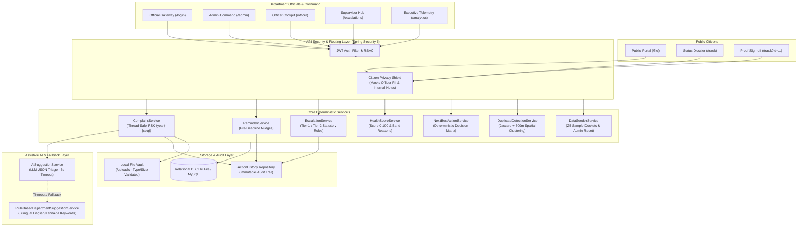

# ResolveTrack: Grievance Follow-up & Statutory Escalation System

[](https://spring.io/projects/spring-boot)
[](https://vitejs.dev/)
[-orange.svg)](https://sakala.karnataka.gov.in)
[](https://tailwindcss.com/)
[](https://junit.org/)
[](https://fonts.google.com/specimen/Noto+Sans+Kannada)

**ResolveTrack** is a high-assurance public grievance redressal and statutory escalation platform engineered for the Government of Karnataka under the **Karnataka Guarantee of Services to Citizens Act (SAKALA), 2011**.

> *"No complaint forgotten. No follow-up missed."*  
> *"ಯಾವುದೇ ದೂರು ಮರೆಯಲಾಗುವುದಿಲ್ಲ. ಯಾವುದೇ ಅನುಸರಣೆ ತಪ್ಪಿಹೋಗುವುದಿಲ್ಲ."*

---

## 1. System Architecture



---

## 2. Architectural Invariants & Project Rules

1. **Deterministic Business Logic**:
   - Deadlines, SLA calculations, reminder cadence, statutory escalations, health scoring, and prescriptive actions reside strictly inside deterministic Java services. AI is never used for legal timelines or penal actions.
2. **AI Assistive Boundary with Strict Fallback**:
   - AI is strictly advisory: it suggests department, priority, and extracted summaries via [`AiSuggestionService.java`](file:///c:/Users/HP/Downloads/stitch_resolvetrack_grievance_portal%20-%20Copy/backend/src/main/java/com/resolvetrack/department/AiSuggestionService.java).
   - Enforces a 5-second timeout and seamlessly falls back to [`RuleBasedDepartmentSuggestionService.java`](file:///c:/Users/HP/Downloads/stitch_resolvetrack_grievance_portal%20-%20Copy/backend/src/main/java/com/resolvetrack/department/RuleBasedDepartmentSuggestionService.java). An authorised official must review and confirm suggestions.
3. **Citizen Privacy Shield**:
   - Public tracking responses via [`/api/public/track/{id}`](file:///c:/Users/HP/Downloads/stitch_resolvetrack_grievance_portal%20-%20Copy/backend/src/main/java/com/resolvetrack/common/PublicController.java) strictly filter out internal officer names, mobile numbers, and departmental deliberations.
4. **Immutable Audit Trail (`action_history`)**:
   - Every state transition, triage confirmation, reminder nudge, escalation, and progress update writes an immutable record with actor type, role, timestamps, and previous/next states.
5. **Non-Destructive Community Duplicate Clustering**:
   - When duplicate grievances are detected within 500 meters with matching keywords, [`DuplicateDetectionService.java`](file:///c:/Users/HP/Downloads/stitch_resolvetrack_grievance_portal%20-%20Copy/backend/src/main/java/com/resolvetrack/complaint/DuplicateDetectionService.java) links them to a shared `CommunityIssue` cluster. Grievances are **never deleted or merged**; each citizen retains their unique tracking ID.
6. **Verified Proof-Based Resolution**:
   - When an officer submits resolution proof, status becomes `RESOLUTION_SUBMITTED`. The citizen verifies satisfactory redressal (`CONFIRMED` $\to$ `RESOLVED`, or `REJECTED` $\to$ `REOPENED` with supervisor alert). If the citizen does not respond within the configurable timeout, it is flagged for supervisor review instead of auto-closing.
7. **Bilingual Polish with Noto Sans Kannada**:
   - All UI text, dynamic health reasons, next-best-action messages, and morning briefings are externalized in `en.json` and `kn.json`. Rendered using `Noto Sans Kannada` font to prevent layout clipping.

---

## 3. Quickstart & Setup Instructions

### Prerequisites
- **Java 17+** (JDK 17, 21, or 25)
- **Node.js 18+** & **npm**

### Step 1: Run Backend Server (Spring Boot 3)
```powershell
# Set Java 17+ home path (adjust if necessary)
$env:JAVA_HOME = "C:\Program Files\Java\jdk-25.0.4.1"

# Run via pre-configured Node launcher (uses H2 file database with Flyway migrations V1-V5):
node run-backend.js

# Or run directly via Maven Wrapper:
cd backend
./mvnw spring-boot:run
```
- **Backend Base URL**: `http://localhost:8080/api`
- **H2 Console**: `http://localhost:8080/h2-console` (JDBC URL: `jdbc:h2:file:./data/resolvetrackdb`)

### Step 2: Run Frontend Development Server (React + Vite)
```powershell
cd frontend
npm install
npm run dev
```
- **Frontend Portal URL**: `http://localhost:5173`

### Step 3: Run Full Backend Test Suite
```powershell
$env:JAVA_HOME = "C:\Program Files\Java\jdk-25.0.4.1"
cd backend
./mvnw test
```
*Current test status*: **89 / 89 tests passing (`BUILD SUCCESS`)**.

### Step 4: Run Frontend Typecheck & Build
```powershell
cd frontend
npm run build
```
*Current build status*: **Zero TypeScript warnings or Vite bundle errors (built in ~9.4s)**.

---

## 4. Role Credentials Directory

The seed migration [`V2__seed_data.sql`](file:///c:/Users/HP/Downloads/stitch_resolvetrack_grievance_portal%20-%20Copy/backend/src/main/resources/db/migration/V2__seed_data.sql) creates the following accounts (all passwords hashed with BCrypt):

| Role | Username | Password | Full Name / Designation | Jurisdiction / Department |
|---|---|---|---|---|
| **ADMIN** | `admin` | `Admin@123` | System Administrator | State Command Centre (All Jurisdictions) |
| **SUPERVISOR** | `supervisor_police` | `Supervisor@123` | Superintendent Ramesh Babu | Police & Cybercrime Divisions |
| **SUPERVISOR** | `supervisor_works` | `Supervisor@123` | Executive Engineer Shivakumar M | Public Works & Civic Infrastructure |
| **OFFICER** | `officer_police` | `Officer@123` | Inspector Rajesh Kumar | Police Department (Central Division) |
| **OFFICER** | `officer_cyber` | `Officer@123` | Sub-Inspector Ananya Rao | Cyber Crime Cell (CID Karnataka) |
| **OFFICER** | `officer_pwd` | `Officer@123` | Asst. Exec. Engineer Suresh Gowda | Public Works Department (Infra Sub-Div) |
| **OFFICER** | `officer_municipal` | `Officer@123` | Health Inspector Manjunath K | Municipal Administration (BBMP Ward 150) |
| **OFFICER** | `officer_electricity`| `Officer@123` | Section Officer Ramesh B | Electricity Dept (BESCOM Indiranagar) |
| **DATA_ENTRY** | `dataentry_operator`| `DataEntry@123` | Bengaluru One Desk Operator | City Civic Counters (Paper & Phone Intake) |
| **CITIZEN** | `citizen_kavitha` | `Admin@123` | Kavitha Deshmukh | Indiranagar, Bengaluru |

*(Convenience development password `pass` is also accepted across official test profiles).*

---

## 5. REST API Gateway Summary

| Domain | Method | Endpoint | Authorization | Description |
|---|---|---|---|---|
| **Public** | `POST` | `/api/public/complaints` | Public | Register grievance with optional multipart files (up to 5MB) |
| **Public** | `GET` | `/api/public/track/{id}` | Public | Privacy-shielded citizen tracking (status, department, public updates) |
| **Public** | `GET` | `/api/complaints/track/{ref}` | Public | Detailed citizen docket with verified proof actions |
| **Public** | `POST` | `/api/public/complaints/{id}/confirm-resolution` | Public | Citizen confirms resolution proof $\to$ `RESOLVED` |
| **Public** | `POST` | `/api/public/complaints/{id}/reject-resolution` | Public | Citizen disputes resolution $\to$ `REOPENED` with supervisor alert |
| **Auth** | `POST` | `/api/auth/login` | Public | Official GovNet authentication; returns signed JWT |
| **Auth** | `GET` | `/api/auth/me` | Authenticated | Retrieve current user profile, role, and department scope |
| **Complaints** | `GET` | `/api/complaints` | Authenticated | Search & filter grievances (dept, status, priority, health score sort) |
| **Complaints** | `GET` | `/api/complaints/{id}` | Authenticated | Full official dossier: internal history, health reasons, NBA action |
| **Complaints** | `PUT` | `/api/complaints/{id}/assign` | `ADMIN`, `SUPERVISOR` | Assign or reassign officer with mandatory statutory audit reason |
| **Complaints** | `POST` | `/api/complaints/{id}/updates` | Assigned Officer / Admin | Submit progress update note, reset SLA deadline, clear reminders |
| **Complaints** | `POST` | `/api/complaints/{id}/submit-resolution` | Assigned Officer / Admin | Submit proof-based resolution (summary + optional file evidence) |
| **Complaints** | `POST` | `/api/complaints/suggest-triage` | Authenticated | On-demand assistive AI triage recommendation with rule fallback |
| **Reminders** | `GET` | `/api/reminders` | Authenticated | View pre-deadline warning nudges scoped to officer |
| **Reminders** | `POST` | `/api/reminders/{id}/acknowledge` | Assigned Officer / Admin | Single-click reminder acknowledgment |
| **Escalations** | `GET` | `/api/escalations` | `SUPERVISOR`, `ADMIN` | View Tier-1 (Ward) and Tier-2 (District Collector) statutory escalations |
| **Escalations** | `POST` | `/api/escalations/{id}/acknowledge` | `SUPERVISOR`, `ADMIN` | Acknowledge statutory escalation docket |
| **Audit Log** | `GET` | `/api/history/{complaintId}` | Authenticated | Immutable chronological audit trail (`action_history`) |
| **Dashboard** | `GET` | `/api/dashboard/summary` | Authenticated | Real-time counts (total, new, assigned, in-progress, overdue, resolved) |
| **Dashboard** | `GET` | `/api/dashboard/recommended-actions` | `OFFICER`, `SUPERVISOR` | Prescriptive grouped actions for today's operational intervention |
| **Analytics** | `GET` | `/api/dashboard/analytics` | `ADMIN`, `SUPERVISOR` | Aggregated SLA resolution times, overdue rates, officer caseloads |
| **Briefing** | `GET` | `/api/dashboard/briefing` | `SUPERVISOR`, `ADMIN` | Morning briefing narrative with top-priority flagged docket |
| **Settings** | `GET` | `/api/settings` | Authenticated | Retrieve system configuration & category SLA matrices |
| **Settings** | `PUT` | `/api/settings/{key}` | `ADMIN` | Update statutory SLA thresholds and escalation intervals |
| **Admin Seed** | `POST` | `/api/admin/reset-and-reseed` | `ADMIN` | Admin-only wipe & reseed of 25 realistic sample grievances |
| **Demo Mode** | `POST` | `/api/dev/demo/set-mode` | Public / Dev | Toggle Live Demo Accelerator (minutes instead of hours/days) |
| **Demo Mode** | `POST` | `/api/dev/demo/run-cycle` | Public / Dev | Manually trigger follow-up cycle (reminders, overdue, escalations) |

---

## 6. Live Demo Walkthrough Script

Follow these 8 steps to demonstrate the end-to-end functionality to stakeholders:

1. **Reset & Reseed Demo Data**:
   - Log in as `admin` (`Admin@123`), navigate to **Settings** (`/settings`).
   - Click **"Reset & Reseed Demo (25 Dockets)"**. The system cleans transactional tables and seeds 25 realistic sample grievances across Police and Civic departments, including 3 streetlight duplicates and 1 escalated docket (`RSK-2026-018`).
2. **Review Admin Command Centre**:
   - Navigate to `/admin`. Inspect the 25 grievances sorted by Health Score deficiency.
   - Observe the 2 Critical dockets highlighted in red (`RSK-2026-016` and `RSK-2026-017`).
3. **Citizen Lodges a New Grievance**:
   - Open `/file`. Fill out the form with a water rupture on 8th Main Road, Vidyaranyapura.
   - Note that tracking ID `RSK-2026-026` is sequentially generated without collision.
4. **Citizen Privacy Shield Verification**:
   - Open `/track?id=RSK-2026-026`.
   - Verify that the status shows `NEW` and the department is identified as BBMP. Note that officer names, phone numbers, and internal deliberations are strictly omitted.
5. **AI Suggestion & Admin Assignment**:
   - In `/admin`, open complaint `RSK-2026-026`. Click **"Ask AI Suggestion"** to see assistive recommendation.
   - Assign the grievance to Health Inspector Manjunath K (`EMP-MUN-001`) with reason *"Emergency repair crew mobilized"*.
6. **Officer Field Update & Health Recalculation**:
   - Log in as `officer_municipal` (`Officer@123`) $\to$ `/officer`.
   - Inspect the **Recommended Actions** panel. Open the docket, post a progress note, and check the public update checkbox.
   - Return to `/track?id=RSK-2026-026` as a citizen to see the public note appear on the citizen timeline.
7. **Fast-Forward Demo Mode & Trigger Escalation**:
   - In **Settings** (`/settings`), toggle **"Live Demonstration Mode"** to ON.
   - Click **"Run Cycle Now"**. The engine evaluates minute-based deadlines, dispatches pre-deadline reminders to `/reminders`, transitions overdue complaints, and creates Tier-1 escalations in `/escalations`.
8. **Executive Analytics & Leaflet Spatial Heatmap**:
   - Open **Analytics** (`/analytics`).
   - Review the **Supervisor Morning Briefing** banner with the top-priority docket inspect button.
   - Explore the **Recharts Weekly Inflow vs Resolution Flow** chart and the **Leaflet Geographic Density Hotspot** heatmap rendered strictly from anonymized jurisdiction centroids.
   - Toggle language to **Kannada** using the top bar toggle (`?lng=kn`) to observe complete rendering in `Noto Sans Kannada`.

---

## 7. Visual Proof & Screenshots Gallery

All screenshots were captured live via Microsoft Edge headless automation and persisted in `screenshots/`:

| # | Screenshot Artifact | Description |
|---|---|---|
| 01 | [`01-login-screen.png`](file:///c:/Users/HP/Downloads/stitch_resolvetrack_grievance_portal%20-%20Copy/screenshots/01-login-screen.png) | Official GovNet authentication with role-based routing and demo credentials. |
| 02 | [`02-file-grievance-form.png`](file:///c:/Users/HP/Downloads/stitch_resolvetrack_grievance_portal%20-%20Copy/screenshots/02-file-grievance-form.png) | Citizen public lodgement form with SLA matrix computation and file upload. |
| 03 | [`03-citizen-tracking-new.png`](file:///c:/Users/HP/Downloads/stitch_resolvetrack_grievance_portal%20-%20Copy/screenshots/03-citizen-tracking-new.png) | Citizen tracking docket verifying privacy shield (zero officer PII). |
| 04 | [`04-admin-dashboard.png`](file:///c:/Users/HP/Downloads/stitch_resolvetrack_grievance_portal%20-%20Copy/screenshots/04-admin-dashboard.png) | Admin dashboard with KPI metrics, status filters, and health score deficiency sort. |
| 05 | [`05-complaint-details-admin.png`](file:///c:/Users/HP/Downloads/stitch_resolvetrack_grievance_portal%20-%20Copy/screenshots/05-complaint-details-admin.png) | Admin complaint inspection with AI assistive triage confirmation banner. |
| 06 | [`06-officer-dashboard.png`](file:///c:/Users/HP/Downloads/stitch_resolvetrack_grievance_portal%20-%20Copy/screenshots/06-officer-dashboard.png) | Officer cockpit scoped to active assigned grievances and SLA warnings. |
| 07 | [`07-complaint-updated-officer.png`](file:///c:/Users/HP/Downloads/stitch_resolvetrack_grievance_portal%20-%20Copy/screenshots/07-complaint-updated-officer.png) | Officer logging progress note with public citizen timeline broadcast flag. |
| 08 | [`08-reminder-centre.png`](file:///c:/Users/HP/Downloads/stitch_resolvetrack_grievance_portal%20-%20Copy/screenshots/08-reminder-centre.png) | Early warning reminder center with single-click nudge acknowledgment. |
| 09 | [`09-escalation-centre.png`](file:///c:/Users/HP/Downloads/stitch_resolvetrack_grievance_portal%20-%20Copy/screenshots/09-escalation-centre.png) | Multi-tier statutory escalation hub (Tier 1 Ward / Tier 2 District Collector). |
| 10 | [`10-action-history.png`](file:///c:/Users/HP/Downloads/stitch_resolvetrack_grievance_portal%20-%20Copy/screenshots/10-action-history.png) | Immutable audit log recording transitions, actors, and system actions. |
| 11 | [`11-citizen-tracking-updated.png`](file:///c:/Users/HP/Downloads/stitch_resolvetrack_grievance_portal%20-%20Copy/screenshots/11-citizen-tracking-updated.png) | Public citizen tracking view reflecting live officer progress update note. |
| 12 | [`12-complaint-details-full.png`](file:///c:/Users/HP/Downloads/stitch_resolvetrack_grievance_portal%20-%20Copy/screenshots/12-complaint-details-full.png) | Comprehensive complaint dossier embedding interactive Leaflet OpenStreetMap pin. |
| 13 | [`13-citizen-tracking-reopened-cluster.png`](file:///c:/Users/HP/Downloads/stitch_resolvetrack_grievance_portal%20-%20Copy/screenshots/13-citizen-tracking-reopened-cluster.png) | Reopened complaint banner with non-destructive neighborhood duplicate cluster notice. |
| 14 | [`14-complaint-details-reopened-nba.png`](file:///c:/Users/HP/Downloads/stitch_resolvetrack_grievance_portal%20-%20Copy/screenshots/14-complaint-details-reopened-nba.png) | Health score breakdown (-20 pts dispute) and prescriptive Next Best Action directive. |
| 15 | [`15-officer-dashboard-recommended-actions.png`](file:///c:/Users/HP/Downloads/stitch_resolvetrack_grievance_portal%20-%20Copy/screenshots/15-officer-dashboard-recommended-actions.png) | Officer cockpit aggregating today's highest-priority statutory interventions. |
| 16 | [`16-analytics-dashboard-kpis-recharts-heatmap.png`](file:///c:/Users/HP/Downloads/stitch_resolvetrack_grievance_portal%20-%20Copy/screenshots/16-analytics-dashboard-kpis-recharts-heatmap.png) | Executive analytics dashboard with 5 KPI cards, Recharts case flow, and Leaflet heatmap. |
| 17 | [`17-supervisor-morning-briefing.png`](file:///c:/Users/HP/Downloads/stitch_resolvetrack_grievance_portal%20-%20Copy/screenshots/17-supervisor-morning-briefing.png) | Supervisor morning briefing card with top-priority flagged docket inspection. |
| 18 | [`18-analytics-kannada-font-rendering.png`](file:///c:/Users/HP/Downloads/stitch_resolvetrack_grievance_portal%20-%20Copy/screenshots/18-analytics-kannada-font-rendering.png) | Full bilingual Kannada UI rendered with crisp `Noto Sans Kannada` typography. |
| 19 | [`19-settings-admin-reset-reseed-demo-mode.png`](file:///c:/Users/HP/Downloads/stitch_resolvetrack_grievance_portal%20-%20Copy/screenshots/19-settings-admin-reset-reseed-demo-mode.png) | System settings featuring Admin Reset & Reseed button, Demo Mode switch, and Run Cycle button. |
| 20 | [`20-admin-dashboard-25-seeded-complaints.png`](file:///c:/Users/HP/Downloads/stitch_resolvetrack_grievance_portal%20-%20Copy/screenshots/20-admin-dashboard-25-seeded-complaints.png) | Admin dashboard roster displaying all 25 realistic sample complaints across Police and Civic dockets. |
| 21 | [`21-escalation-centre-seeded-tier1.png`](file:///c:/Users/HP/Downloads/stitch_resolvetrack_grievance_portal%20-%20Copy/screenshots/21-escalation-centre-seeded-tier1.png) | Escalation Centre displaying the pre-escalated Tier-1 docket (`RSK-2026-018`) with supervisor alert. |

---

## 8. Security Architecture & Audit Review

1. **Password Hashing & Storage**:
   - Passwords are encrypted using **BCrypt 10 rounds** via `BCryptPasswordEncoder` in [`SecurityConfig.java`](file:///c:/Users/HP/Downloads/stitch_resolvetrack_grievance_portal%20-%20Copy/backend/src/main/java/com/resolvetrack/auth/SecurityConfig.java). Cleartext passwords are never persisted.
2. **File Upload Security & Validation**:
   - Implemented in [`FileUploadService.java`](file:///c:/Users/HP/Downloads/stitch_resolvetrack_grievance_portal%20-%20Copy/backend/src/main/java/com/resolvetrack/complaint/FileUploadService.java):
     - **Size Ceiling**: Strict 5 MB file size limit enforced before disk write.
     - **MIME & Extension Whitelist**: Strictly allows JPEG, PNG, WEBP, GIF, and PDF. Executable files (`.exe`, `.sh`, `.jsp`, `.php`) are rejected with `400 Bad Request`.
     - **Path Traversal Protection**: Uses `StringUtils.cleanPath()` and persists files using generated `UUID.randomUUID()` filenames, preventing directory traversal attacks.
3. **Role-Based Access Control (RBAC)**:
   - Configured with `@EnableMethodSecurity(prePostEnabled = true)` and URL-level antMatchers.
   - Admin-only routes (`/api/admin/**`, `/api/settings/**`) require `ROLE_ADMIN`.
   - Supervisor routes (`/api/escalations/**`) require `ROLE_SUPERVISOR` or `ROLE_ADMIN`.
   - Officer routes require assigned ownership verified via [`ComplaintSecurityService.java`](file:///c:/Users/HP/Downloads/stitch_resolvetrack_grievance_portal%20-%20Copy/backend/src/main/java/com/resolvetrack/complaint/ComplaintSecurityService.java).
4. **Citizen Privacy Shield (Data Masking)**:
   - The public tracking endpoint [`GET /api/public/track/{id}`](file:///c:/Users/HP/Downloads/stitch_resolvetrack_grievance_portal%20-%20Copy/backend/src/main/java/com/resolvetrack/common/PublicController.java) returns only `PublicTrackResponse` (status, department name, latest public progress note, and resolved boolean).
   - Internal officer remarks, personal employee codes, officer phone numbers, and citizen contact numbers of co-docket holders are completely masked.
5. **Aggregated Telemetry (Zero PII in Analytics)**:
   - The analytics heatmap in [`AreaHeatmap.tsx`](file:///c:/Users/HP/Downloads/stitch_resolvetrack_grievance_portal%20-%20Copy/frontend/src/components/common/AreaHeatmap.tsx) operates exclusively on sub-division centroids (`AreaOverdue` records) with circular radius proportional to density. No citizen home addresses, cadastral survey numbers, or GPS traces are exposed in analytical payloads.
